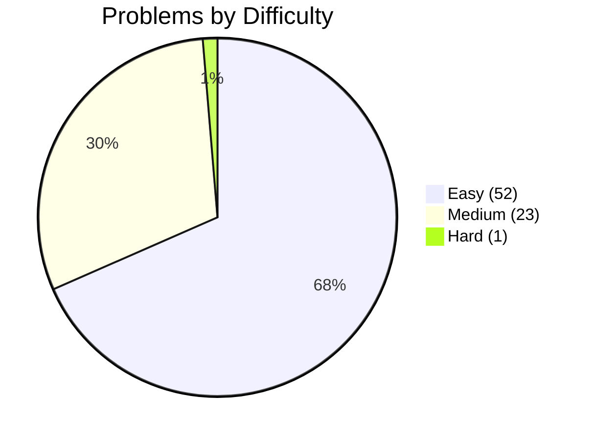
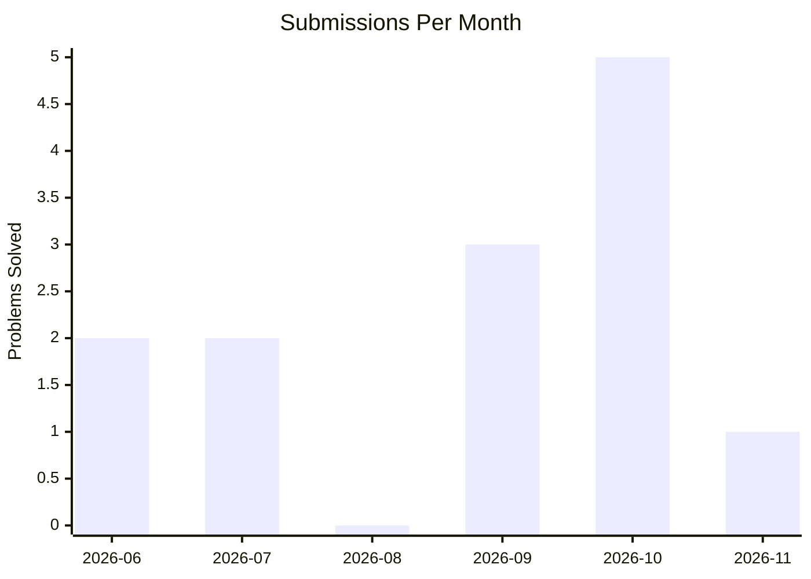

# LeetCode Progress

    

### Current Month Activity
| Sun | Mon | Tue | Wed | Thu | Fri | Sat |
| --- | --- | --- | --- | --- | --- | --- |
| ❌ | ❌ | ❌ | ❌ | ❌ | ❌ | ❌ |
| ❌ | ❌ | ✅ |   |   |   |   |
|   |   |   |   |   |   |   |
|   |   |   |   |   |   |   |
|   |   | - | - | - | - | - |

### Activity Heatmap (Last 3 Months)

### Missed Days
| Date | Day |
| --- | --- |
| 2026-10-30 | Friday |
| 2026-11-01 | Sunday |
| 2026-11-02 | Monday |
| 2026-11-03 | Tuesday |
| 2026-11-04 | Wednesday |
| 2026-11-05 | Thursday |
| 2026-11-06 | Friday |
| 2026-11-07 | Saturday |
| 2026-11-08 | Sunday |
| 2026-11-09 | Monday |
| ... | ... (541 total missed days) |

### Milestones
- [x] First problem solved
- [ ] 5-day streak
- [x] 10 problems solved
- [x] 25 problems solved
- [x] 50 problems solved
- [ ] 100 problems solved
- [ ] 200 problems solved
- [ ] 30-day streak

### Difficulty Distribution
Easy:   █████████████
Medium: ██████
Hard:   █

