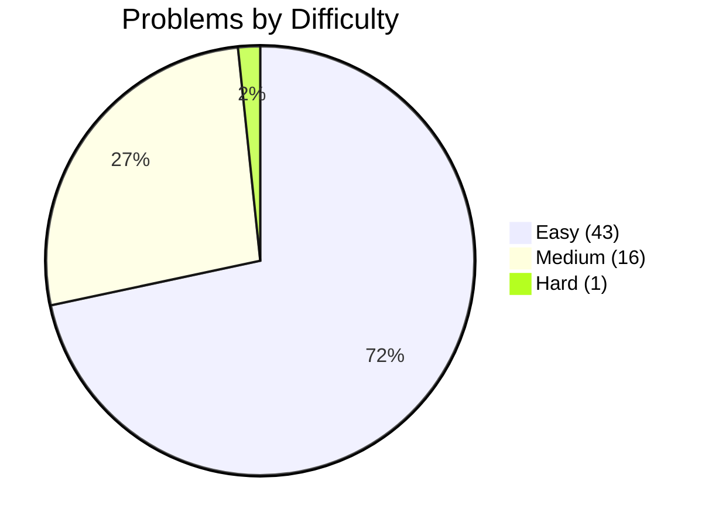
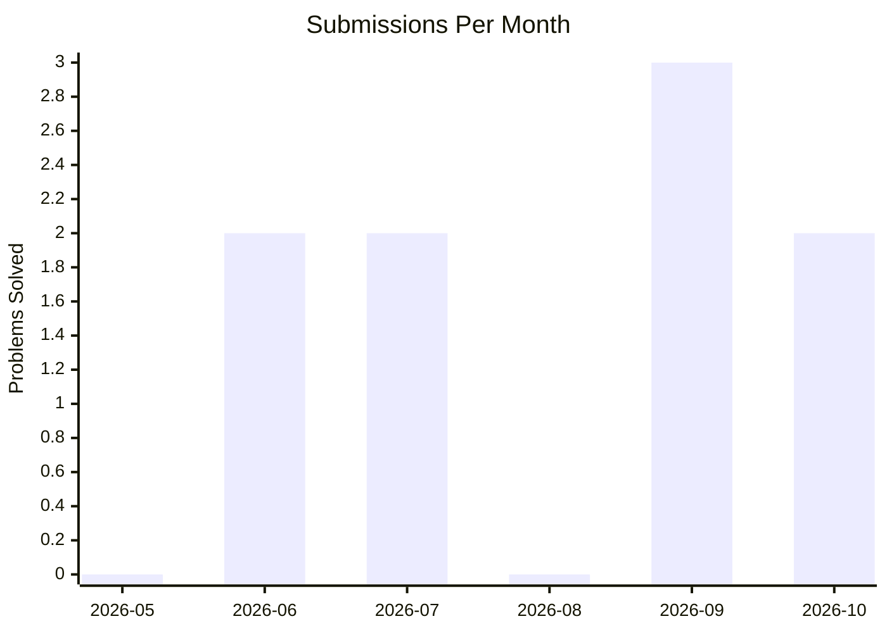
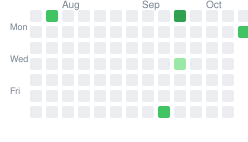

# LeetCode Progress

    

### Current Month Activity
| Sun | Mon | Tue | Wed | Thu | Fri | Sat |
| --- | --- | --- | --- | --- | --- | --- |
| - | - | - | - | ❌ | ❌ | ❌ |
| ❌ | ❌ | ❌ | ❌ | ❌ | ❌ | ❌ |
| ❌ | ❌ | ❌ | ❌ | ❌ | ❌ | ❌ |
| ❌ | ✅ | ✅ |   |   |   |   |
|   |   |   |   |   |   |   |

### Activity Heatmap (Last 3 Months)

### Missed Days
| Date | Day |
| --- | --- |
| 2026-10-09 | Friday |
| 2026-10-10 | Saturday |
| 2026-10-11 | Sunday |
| 2026-10-12 | Monday |
| 2026-10-13 | Tuesday |
| 2026-10-14 | Wednesday |
| 2026-10-15 | Thursday |
| 2026-10-16 | Friday |
| 2026-10-17 | Saturday |
| 2026-10-18 | Sunday |
| ... | ... (524 total missed days) |

### Milestones
- [x] First problem solved
- [ ] 5-day streak
- [x] 10 problems solved
- [x] 25 problems solved
- [x] 50 problems solved
- [ ] 100 problems solved
- [ ] 200 problems solved
- [ ] 30-day streak

### Difficulty Distribution
Easy:   ██████████████
Medium: █████
Hard:   █

